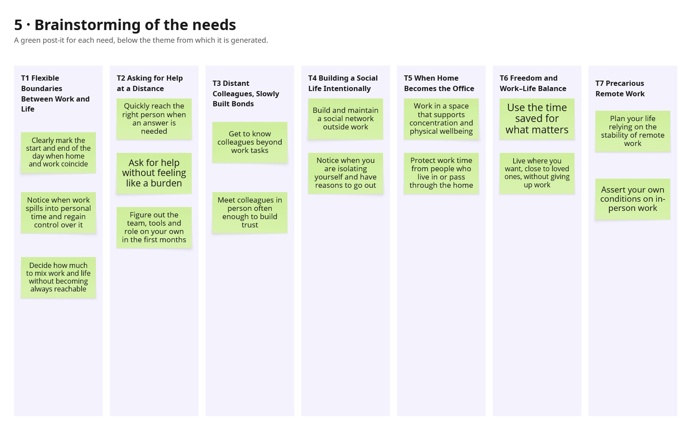

# Project Overview

## 1. Intro

### a. Team members
* Lisa Arduini
* Giuseppe Calvello
* Luisa Crivo
* Francesca De Pascale

### b. Domain of interest and why/how you chose it

* **Domain:** Social wellbeing and work-life boundaries of young adults full-remote workers (under 35)

Full-remote work is a relatively recent phenomenon, in which habits and solutions are still evolving. We focused on remote-workers under 35 because many people in this age group are at the beginning of their careers and build their routines in a context that still lacks established practices to rely on. It is therefore interesting to study how individuals manage their everyday life, work-life boundaries, and social relationships, which can vary greatly from person to person. This approach may allow us to uncover needs that are still little known and largely unexplored.

---

## 2. Methodology

### a. Participants
* **Why were they chosen? Why are they appropriate? How were they recruited? Which is their age, gender, …? Who is the extreme user and why? Who is the
domain expert, if any?**
  * The participants have been chosen because they directly experience the practice we want to explore, allowing us to collect information based on real everyday life.
  * They are appropriate because they belong to, or can speak about, the population of our domain (full-remote workers, mostly under 35) and can describe concretely how they organize their day, separate work from personal life, and maintain social relationships in the context of our domain.
  * Participants were recruited by sending messages on LinkedIn to people matching our target profile, posting on Linkedin groups related to remote work, and by publishing posts on the Reddit platform. We also contacted via e-mail some coworking spaces located in Torino, but received no reply in this case.
  * Moreover, we created a Google Form questionnaire and shared it through the previously mentioned platforms (Reddit and LinkedIn), with two main objectives:
    1. Collect further information about the experience of remote workers, to complement the interviews, and use it to perform a deeper thematic analysis.
    2. Find more participants, by asking respondents whether they were willing to be interviewed and giving them the option to leave their e-mail address so we could contact them. In particular, the extreme user has been recruited thanks to this form.

* **Extreme user:**
  * The extreme user is a full-remote worker over 40 who has been working remotely for 11 years. He is “extreme” because of his seniority in the practice: having lived through remote work over time, he can offer a long-term perspective and show how habits and solutions have consolidated or changed, aspects that younger participants may not have experienced yet. He deliberately falls outside the under-35 range for this reason.

* **Domain expert:**
  * The domain expert is a work psychologist, chosen to offer an external professional perspective on wellbeing in the workplace, to be compared with the experiences reported by the other participants.
 
| Participant | Age | Gender | Professional role |
| :--- | :--- | :--- | :--- |
| Immediate user 1 | 33 | Male | Budget and contracts development for clinical trials |
| Immediate user 2 | 28 | Female | Product owner |
| Immediate user 3 | 34 | Female | Solution architect |
| Immediate user 4 | 29 | Male | Software sales |
| Extreme user | 42 | Male | Sys admin |
| Domain expert | n/d | Female | Work psychologist |

### b. Where were the interviews conducted?
* **Extreme user:** The interview has been conducted online (Google Meet) because the participant is based in France.
* **Immediate user 1:** The interview has been conducted in a public park in Torino, as explicitly requested by the participant.
* **Immediate user 2:** The interview has been conducted at the interviewee's home.
* **Immediate user 3:** The interview has been conducted at the interviewee's home.
* **Immediate user 4:** The interview has been conducted online (Google Meet) because the participant is not based in Italy.

### c. What did you observe (if any) and ask (i.e., questions)?
* The list of questions we asked is contained in the files [`QuestionsImmediateUser.md`](./interviews/questions/QuestionsImmediateUser.md), [`QuestionsExtremeIT.md`](./interviews/questions/QuestionsExtremeIT.md), and [`QuestionsDomainExpert.md`](./interviews/questions/QuestionsDomainExpert.md).
* In particular, the questions asked to the extreme user were personalized based on what he wrote in the questionnaire, and served as follow-up questions to explore some specific aspects more in depth.
* GOOGLE FORM: https://docs.google.com/forms/d/e/1FAIpQLSfKr93cgz-TDBY6pAzW0AD8rrnYMGjbF621t99qtgOYimQ1PQ/viewform
* Since the work environment of our participants is mainly their own home, a direct observation would have been intrusive. However, some participants kindly shared with us pictures of their work setup (desk, monitors etc.), giving us a partial view of the physical context in which they work, complementing what they described verbally during the interviews.

### d. Team member roles for each interview
* **Extreme user:** Giuseppe Calvello conducted the interview asking the questions; Lisa Arduini audio-recorded the interview and took notes.
* **Immediate user 1:** Lisa Arduini conducted the interview asking the questions; Francesca De Pascale audio-recorded the interview and took notes.
* **Immediate user 2:** Francesca De Pascale conducted the interview asking the questions, audio-recorded the interview and took notes.
* **Immediate user 3:** Luisa Crivo conducted the interview asking the questions, audio-recorded the interview and took notes.
* **Immediate user 4:** Lisa Arduini conducted the interview asking the questions; Luisa Crivo audio-recorded the interview and took notes.
* **Domain Expert:** Luisa Crivo conducted the interview asking the questions; Francesca De Pascale audio-recorded the interview and took notes.

### e. Any material you used (camera, recorder, etc.)
* Audio-recordings have been taken through our smartphones.
* Pen and paper have been used to take notes during the interviews.

--- 

## 3. Results

### a. Pictures and relevant artifacts

  

*Figure 1. A dedicated home workspace with a separate desk, external monitor, ergonomic chair, and a clean environment designed to reduce distractions.*

  

*Figure 2. A more complex remote-work setup with multiple monitors, an external keyboard, a laptop stand, and additional equipment supporting long and technical work sessions.*

  

*Figure 3. A home workspace placed in a shared living area, with natural light, an external monitor, and an ergonomic chair.*

--- 

## 4. User needs

### a. Include a list/picture/screenshot of all the brainstormed user needs

Starting from the results of the thematic analysis, we brainstormed the user needs that emerged from each theme, defining them as activities and desires with which users could use help ("needs a way to…"), rather than solutions. We identified them in two ways: directly from recurring user traits, and from contradictions between intentions and actions (based on what participants declared). Each need is linked to the theme it originates from.

### b. Present the 3-4 deep user needs; explicitly connect each of them to one or more thematic analysis’ themes

From this list, we selected the four needs that we considered the most insightful. We looked for needs that are supported by several interviews and user types, that capture a pattern in the data rather than a single complaint, and that are broad enough to later be the main goal of an interactive application.

#### Deep needs

| Deep need | Corresponding themes | Motivation |
| :--- | :--- | :--- |
| **1. Noticing when work spills into personal time and regaining control, without losing remote flexibility** | T1 Flexible Boundaries Between Work and Life T6 Freedom and Work–Life Balance | Overlap between work and personal time appears in all 6 interviews, through different forms (see codes C13, C15, C18, C19, C20): U3 closes laptop and work phone but reopens them and worries; U4 has no work accounts on his phone but answers clients on WhatsApp; U1 says he works off-hours "very rarely" yet checked emails by the swimming pool... |
| **2. Asking for help and getting to know remote colleagues without feeling like a burden** | T2 Asking for Help at a Distance T3 Distant Colleagues, Slowly Built Bonds | Distant relationships appear in all 6 interviews. Reluctance to disturb appears in U4 and EU (C32), difficulty reaching people in U1, U3, U4 (C31), fragile onboarding in U1, U2, EU (C41). Trust built in person (C43: U2, U3) lowers the barrier to asking, while where it is missing people ask less (U4, EU).EU notes that a quick Slack ping disturbs less than an accumulated list of doubts (E.26), yet people still hold back. |
| **3. Turning saved time into real social life outside the home, before drifting into isolation** | T4 Building a Social Life Intentionally T6 Freedom and Work–Life Balance | Time saved by not commuting (C54) is the benefit everyone cites . However, some interviewees mentioned isolation without personal initiative (C48: U1, PSI), days spent entirely at home (C50: U1, U2, U4), social life that has to be planned (C49), built through interests (C46, C64) or local community (C51, EU). |
| **4. Making work and domestic life coexist in the same space, protecting concentration and physical wellbeing without excluding the people at home** | T1 Flexible Boundaries Between Work and Life T5 When Home Becomes the Office | Workspace issues appear in all 6 interviews (C22–C26), interruptions in U1–U4 and EU (C27), family tensions in EU (C62). People at home can both the source of interruptions and the reason remote work was chosen (C55, e.g. U3's daughter). A dedicated room also works as a mental boundary (C16: U1, U4), which links this need to Deep need 1. |

--- 

## 5. Solutions

**Chosen solution: a support loop for remote teams**

A collaborative support system that helps young remote workers ask for help without feeling like a burden. By combining peer support, shared knowledge, and opportunities to ask questions without pressure, it makes assistance easier to access and encourages stronger relationships among remote colleagues.

**Need addressed (Deep need 2):** users need to ask for help and get to know their colleagues remotely without feeling like a burden.
Themes: T2 Asking for Help Remotely, T3 Remote Colleagues, Slow Bonds.

**Why we selected it:** Starting from the solutions addressing the 4 extracted deep needs, we categorized them using the Four Categories Method. We came up with this final idea mixing up 3 different solutions:
* A support buddy for new employees
* Who-knows-what map
* Question box

  

We chose to combine them because asking for help remotely emerged in the interviews as one of the main problems, with an impact on employees' well-being on both sides of the conversation:
* **Who needs to ask** feels uncomfortable asking or is afraid of disturbing colleagues, and often ends up coping alone. One immediate user explained that, since his manager has seven people to follow, he sometimes feels forced to manage on his own instead of asking (U4). The extreme user described newcomers who are afraid of showing they don't know something and keep their questions to themselves (EU).
* **Who answers** receives the same questions all at once, in large blocks, after weeks of silence. The extreme user told us that when a newcomer finally opens up, "out comes the list of things they wanted to ask and didn't", and that a quick message would disturb far less than half an hour spent on questions that could have been asked two months earlier (EU).

The final solution addresses both sides together: the buddy gives newcomers a safe first person to turn to, the map spreads questions across the people who actually know each topic and shows when they are available, and the question box turns large, unexpected blocks of questions into a regular shared moment, where questions can also be asked anonymously.

---

## 6. Project name and value proposition

**Name:** JarGone

**How we landed on the name:** we imagined the heart of our solution as a jar that collects all the team's questions anonymously, so nobody has to worry about looking inadequate or disturbing a colleague. The name brings this image together with what the solution does. Read aloud, *JarGone* sounds like *jargon*: the team's own language, made of tools, acronyms and unwritten rules, that newcomers struggle to understand and are often too embarrassed to ask about. At the same time, it splits into *jar* + *gone*: questions go into the jar, and doubts are gone once the team answers them together.

**Value proposition:** Questions in, doubts gone.
