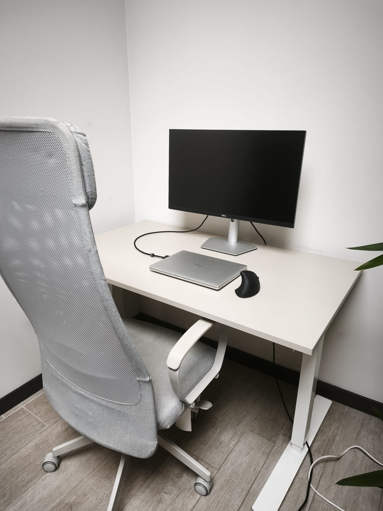
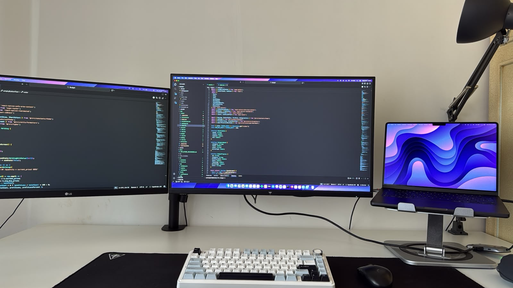
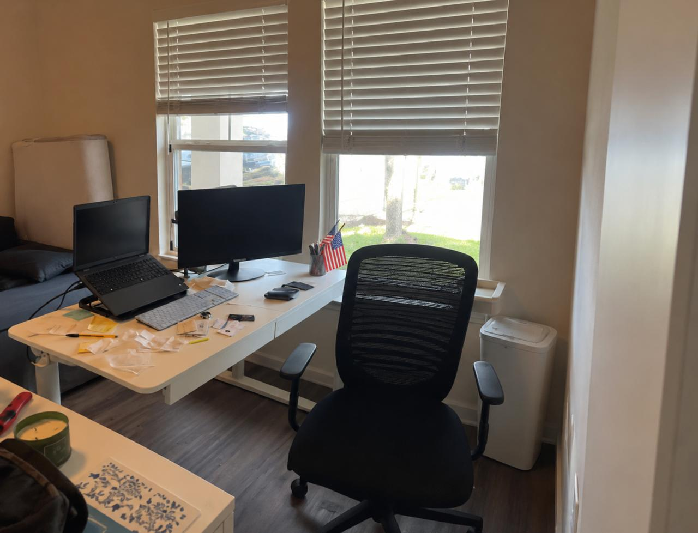

# Project Overview

## 1. Intro

### a. Team members
* Lisa Arduini
* Giuseppe Calvello
* Luisa Crivo
* Francesca De Pascale

### b. Domain of interest and why/how you chose it

* **Domain:** Social wellbeing and work-life boundaries of young adults full-remote workers (under 35)

Full-remote work is a relatively recent phenomenon, in which habits and solutions are still evolving. We focused on remote-workers under 35 because many people in this age group are at the beginning of their careers and build their routines in a context that still lacks established practices to rely on. It is therefore interesting to study how individuals manage their everyday life, work-life boundaries, and social relationships, which can vary greatly from person to person. This approach may allow us to uncover needs that are still little known and largely unexplored.

---

## 2. Methodology

### a. Participants
* **Why were they chosen? Why are they appropriate? How were they recruited? Which is their age, gender, …? Who is the extreme user and why? Who is the
domain expert, if any?**
  * **Why were they chosen?** We interviewed six people: four immediate users, one extreme user and one domain expert. The immediate users are the core of our target: they are under 35, work fully remotely, and live the practice we want to study on a daily basis, so they can describe what actually happened in their last working day, rather than just giving general opinions about remote work. Among the people who matched this profile, we selected participants based on their availability.
  * **Why are they appropriate?** They belong to the population of our domain and can describe concretely how they organize their day, separate work from personal life, and keep social relationships while working from home. Together with the extreme user and the domain expert, they let us look at the topic from three points of view: who lives it now, who has lived it for over ten years, and who observes its effects professionally. Moreover, the four immediate users experience a wide range of **different situations**, which makes them a good sample to see how the way people manage boundaries and social life depends on their context:
    * **Remote seniority:** from 8 months (U4) to 6 years (U3), allowing us to compare someone still building a routine with someone who has already settled into one.
    * **Living situation:** with a partner (U1), with parents and other family members (U2), with a partner and a little daughter (U3), alone during working hours while the partner works on site (U4).
    * **Team and schedule:** an international team split between the Netherlands and the USA (U1), colleagues never met in person (U2), working hours enforced by the system (U4) versus more flexible schedules (U1, U3).
  * **How were they recruited?** We sent direct messages on LinkedIn to people matching our target profile, posted in LinkedIn groups about remote work, and published posts on Reddit. We also contacted some coworking spaces in Torino by e-mail, but received no reply. In addition, we created a Google Form questionnaire (see section 2.c) and shared it on the same platforms, with two goals:
    1. Collect more information about the experience of remote workers, to complement the interviews and support a deeper thematic analysis.
    2. Find more participants, by asking respondents if they were willing to be interviewed and letting them leave their e-mail address. The extreme user was recruited this way.

    All interviewees signed a consent form before the interview (see [`ConsentForm`](./ConsentForm/)).
  * **Which is their age, gender, …?**

| Participant | Age | Gender | Professional role | Fully remote for | Lives with |
| :--- | :--- | :--- | :--- | :--- | :--- |
| Immediate user 1 (U1) | 33 | Male | Budget and contracts development for clinical trials | ~4.5 years | Partner (hybrid worker) |
| Immediate user 2 (U2) | 28 | Female | Product owner | ~3.5 years | Parents and family |
| Immediate user 3 (U3) | 34 | Female | Solution architect (e-commerce) | 6 years | Husband and daughter |
| Immediate user 4 (U4) | 29 | Male | Software sales | 8 months | Wife (works on site) |
| Extreme user (EU) | 42 | Male | System administrator / architect | 11 years | Alone |
| Domain expert (PSI) | n/d | Female | Work psychologist | – | – |

* **Who is the extreme user and why?**
  * The extreme user is a 42-year-old system administrator who has worked fully remotely for 11 years. Remote work allowed him to leave the city (he was living in Sweden at the time) and move to the French Alps, closer to his elderly parents. He lives alone and has a senior role without fixed working hours.
  * He is "extreme" because of his **seniority in the practice**: he started working remotely when it was still uncommon, so he can show how habits and solutions settle over the years and which problems remain even after a long time. He also sees the practice from the other side, because he welcomes and supports new colleagues who join the team remotely. For these reasons he deliberately falls outside the under-35 range.

* **Who is the domain expert, if any?**
  * The domain expert is a work psychologist. We chose her to get an external, professional view on wellbeing at work and on the expectations of young workers, to compare with what the users told us.
  * Her under-35 patients mostly work in hybrid mode (e.g. from home on Fridays) rather than fully remote, so her contribution is mainly about the psychological effects of flexibility, isolation and work–life balance, rather than about full-remote daily routines.

### b. Where were the interviews conducted?
* **Extreme user:** The interview has been conducted online (Google Meet) because the participant is based in France.
* **Domain expert:** The interview has been conducted in her office.
* **Immediate user 1:** The interview has been conducted in a public park in Torino, as explicitly requested by the participant.
* **Immediate user 2:** The interview has been conducted at the interviewee's home.
* **Immediate user 3:** The interview has been conducted at the interviewee's home.
* **Immediate user 4:** The interview has been conducted online (Google Meet) because the participant is based in the United States.

### c. What did you observe (if any) and ask (i.e., questions)?
* The list of questions we asked is contained in the files [`QuestionsImmediateUser.md`](./interviews/questions/QuestionsImmediateUser.md), [`QuestionsExtremeIT.md`](./interviews/questions/QuestionsExtremeIT.md), and [`QuestionsDomainExpert.md`](./interviews/questions/QuestionsDomainExpert.md).
* In particular, the questions asked to the extreme user were personalized based on what he wrote in the questionnaire, and served as follow-up questions to explore some specific aspects more in depth.
* GOOGLE FORM: https://docs.google.com/forms/d/e/1FAIpQLSfKr93cgz-TDBY6pAzW0AD8rrnYMGjbF621t99qtgOYimQ1PQ/viewform
* Since the work environment of our participants is mainly their own home, a direct observation would have been intrusive. However, some participants kindly shared with us pictures of their work setup (desk, monitors etc.), giving us a partial view of the physical context in which they work, complementing what they described verbally during the interviews.

### d. Team member roles for each interview
* **Extreme user:** Giuseppe Calvello conducted the interview asking the questions; Lisa Arduini audio-recorded the interview and took notes.
* **Immediate user 1:** Lisa Arduini conducted the interview asking the questions; Francesca De Pascale audio-recorded the interview and took notes.
* **Immediate user 2:** Francesca De Pascale conducted the interview asking the questions; Giuseppe Calvello audio-recorded the interview and took notes.
* **Immediate user 3:** Luisa Crivo conducted the interview asking the questions; Giuseppe Calvello audio-recorded the interview and took notes.
* **Immediate user 4:** Lisa Arduini conducted the interview asking the questions; Luisa Crivo audio-recorded the interview and took notes.
* **Domain Expert:** Luisa Crivo conducted the interview asking the questions; Francesca De Pascale audio-recorded the interview and took notes.

### e. Any material you used (camera, recorder, etc.)
* Audio-recordings have been taken through our smartphones.
* Pen and paper have been used to take notes during the interviews.

--- 

## 3. Results

### a. Pictures and relevant artifacts

  

*Figure 1. A dedicated home workspace with a separate desk, external monitor, ergonomic chair, and a clean environment designed to reduce distractions.*

  

*Figure 2. A more complex remote-work setup with multiple monitors, an external keyboard, a laptop stand, and additional equipment supporting long and technical work sessions.*

  

*Figure 3. A home workspace placed in a shared living area, with natural light, an external monitor, and an ergonomic chair.*

### b. Themes from the thematic analysis with key quotes

We coded the interview transcripts (66 codes, C01–C66) and the open-ended answers of the questionnaire (56 codes, S01–S56, from 158 excerpts of 15 respondents). We first grouped the interview codes into six candidate themes, then reviewed them using the questionnaire codes. During this review, one theme was split into two, one was dissolved and its codes were reassigned, while a new theme emerged from the combined interview and questionnaire data. The result is **seven final themes**, summarized below with some representative quotes translated from Italian.

| **Theme** | **Subthemes** | **Key quotes** |
| --- | --- | --- |
| **T1 – Flexible Boundaries Between Work and Life** | a. Disconnection strategies and structures b. When boundaries break down c. Permeability as a choice | “I close the computer and the work phone, so nobody can contact me.” — Immediate User 3  “I prefer less separation between work and life and more freedom in organizing my time.” — Extreme User |
| **T2 – Asking for Help Remotely** | a. Reaching people b. Fear of disturbing others c. Fragile onboarding | “Instead of just going to their office, you have to find a moment when they are available.” — Immediate User 3  “Sometimes I feel forced to figure things out on my own.” — Immediate User 4 |
| **T3 – Distant Colleagues, Slowly Built Bonds** | a. Cordial but Distant Relationships b. Meeting in Person | “Since we met in person, our relationship has become much more informal and close.” — Immediate User 2  “We joke and chat, but it is still a virtual relationship.” — Immediate User 1 |
| **T4 – Building a Social Life Intentionally** | a. Building a Social Network Outside Work b. The Risk of Isolation | “If you don't have hobbies or you're not willing to go out, it can become very isolating.” — Immediate User 1  “Sometimes I have to make myself go out.” — Questionnaire respondent |
| **T5 – When Home Becomes Office** | a. Space and Physical Well-Being b. Other People at Home | “I only go into that room to work.” — Immediate User 4  “I tried to create a space where I could be quiet and avoid interruptions from my family.” — Immediate User 2 |
| **T6 – Freedom and Work–Life Balance** | a. Time Regained b. Location and Family | “When the working day ends, you're already home and you can do whatever you want.” — Immediate User 3  “Remote work allowed me to leave the big city and move to the mountains.” — Extreme User |
| **T7 – Precarious Remote Work** | a. Fear of Losing Remote Work b. The relationship with the office | “There are no contractual guarantees [...] losing this level of well-being is what worries me the most.” — Questionnaire respondent  “I would consider hybrid work only if the office were close to home.” — Questionnaire respondent |

The full analysis, with all codes, excerpts in the original language and the review decisions, is in the following files:
* [`Interview Coding and Candidate Themes.md`](./analysis/themes/Interview%20Coding%20and%20Candidate%20Themes.md): interview codes, excerpts for each participant, and candidate themes.
* [`Form_Coding.md`](./analysis/themes/Form_Coding.md): questionnaire codes and coded answers for each respondent.
* [`Theme Review and Final Themes.md`](./analysis/themes/Theme%20Review%20and%20Final%20Themes.md): review of the candidate themes and definition of the seven final themes.

--- 

## 4. User needs

### a. Introduce the user needs

Starting from the results of the thematic analysis, we brainstormed the user needs that emerged from each theme, defining them as activities and desires with which users could use help ("needs a way to…"), rather than solutions. We identified them in two ways: directly from recurring user traits, and from contradictions between intentions and actions (based on what participants declared). Each need is linked to the theme it originates from.

  

### b. Introduce the deep user needs

From this list, we selected the four needs that we considered the most insightful. We looked for needs that are supported by several interviews and user types, that capture a pattern in the data rather than a single complaint, and that are broad enough to later be the main goal of an interactive application.

#### Deep needs

| Deep need | Corresponding themes | Motivation |
| :--- | :--- | :--- |
| **1. Noticing when work spills into personal time and regaining control, without losing remote flexibility** | T1 Flexible Boundaries Between Work and Life T6 Freedom and Work–Life Balance | Overlap between work and personal time appears in all 6 interviews, through different forms (see codes C13, C15, C18, C19, C20): U3 closes laptop and work phone but reopens them and worries; U4 has no work accounts on his phone but answers clients on WhatsApp; U1 says he works off-hours "very rarely" yet checked emails by the swimming pool... |
| **2. Asking for help and getting to know remote colleagues without feeling like a burden** | T2 Asking for Help at a Distance T3 Distant Colleagues, Slowly Built Bonds | Distant relationships appear in all 6 interviews. Reluctance to disturb appears in U4 and EU (C32), difficulty reaching people in U1, U3, U4 (C31), fragile onboarding in U1, U2, EU (C41). Trust built in person (C43: U2, U3) lowers the barrier to asking, while where it is missing people ask less (U4, EU).EU notes that a quick Slack ping disturbs less than an accumulated list of doubts (E.26), yet people still hold back. |
| **3. Turning saved time into real social life outside the home, before drifting into isolation** | T4 Building a Social Life Intentionally T6 Freedom and Work–Life Balance | Time saved by not commuting (C54) is the benefit everyone cites. However, some interviewees mentioned isolation without personal initiative (C48: U1, PSI), days spent entirely at home (C50: U1, U2, U4), social life that has to be planned (C49), built through interests (C46, C64) or local community (C51, EU). |
| **4. Making work and domestic life coexist in the same space, protecting concentration and physical wellbeing without excluding the people at home** | T1 Flexible Boundaries Between Work and Life T5 When Home Becomes the Office | Workspace issues appear in all 6 interviews (C22–C26), interruptions in U1–U4 and EU (C27), family tensions in EU (C62). People at home can both the source of interruptions and the reason remote work was chosen (C55, e.g. U3's daughter). A dedicated room also works as a mental boundary (C16: U1, U4), which links this need to Deep need 1. |

--- 
## 5. Solutions

### a. Brainstorming

Starting from the four deep user needs identified in the previous step, we conducted a brainstorming session to explore different possible ways of addressing each need.

For each deep need, we generated several ideas without initially considering technical feasibility or trying to define specific app features. The goal was to explore a wide range of possible approaches before selecting one direction.

Overall, we generated **24 possible solutions**, six for each deep need.

  

The brainstorming covered four main areas:

- **Deep need 1:** helping remote workers maintain control over the boundaries between work and personal life.
- **Deep need 2:** helping remote workers ask for help and build relationships with colleagues without feeling like a burden.
- **Deep need 3:** helping remote workers turn the time gained through remote work into opportunities for social interaction.
- **Deep need 4:** helping people manage working and living in the same physical space.

The generated ideas included different approaches such as end-of-day routines, shared availability rules, support buddies, question boxes, informal coffee chats, local social activities, focus signals at home, and shared break routines.

### b. Selection of the final solution

After the brainstorming phase, we used the **Four Categories Method** to compare and discuss the proposed ideas.

  

Rather than selecting a single brainstorming idea exactly as it was originally proposed, we decided to combine three complementary ideas related to **Deep need 2**:

- **A support buddy for new employees**
- **Who-knows-what map**
- **Question box**

### c. Chosen solution: a support loop for remote teams

A collaborative support system that helps young remote workers ask for help without feeling like a burden. By combining peer support, shared knowledge, and opportunities to ask questions without pressure, it makes assistance easier to access and encourages stronger relationships among remote colleagues.

**Need addressed (Deep need 2):** users need to ask for help and get to know their colleagues remotely without feeling like a burden.

**Related themes:**
- **T2 – Asking for Help Remotely**
- **T3 –  Distant Colleagues, Slowly Built Bonds**

### d. Why we selected it

Asking for help remotely emerged from the interviews as one of the most relevant difficulties, affecting both the person asking for support and the person providing it.

**For the person asking for help**, contacting a colleague can feel intrusive. Some participants reported trying to solve problems independently rather than disturbing someone else.

One immediate user explained that, since his manager has several people to support, he sometimes feels forced to manage problems on his own instead of asking for help (U4).

The extreme user described a similar situation during remote onboarding: newcomers may be afraid of showing that they do not know something and therefore keep their questions to themselves (EU).

**For the person providing help**, this hesitation can create the opposite problem. Questions are sometimes accumulated and asked all at once instead of being addressed when they first arise.

The extreme user explained that when a newcomer finally starts asking questions, *“out comes the list of things they wanted to ask and didn't”*. He also noted that a quick message would be much less disruptive than spending a long time answering questions that could have been addressed earlier.

The final solution therefore addresses both sides of the interaction:

- the **support buddy** gives newcomers a trusted first person to contact;
- the **who-knows-what map** helps workers understand who has the right knowledge and who may be available to help;
- the **question box** provides a low-pressure way to collect questions and discuss them at a regular moment, with the possibility of asking anonymously.
---

## 6. Project name and value proposition

**Name:** JarGone

**How we landed on the name:** we imagined the heart of our solution as a jar that collects all the team's questions anonymously, so nobody has to worry about looking inadequate or disturbing a colleague. The name brings this image together with what the solution does. Read aloud, *JarGone* sounds like *jargon*: the team's own language, made of tools, acronyms and unwritten rules, that newcomers struggle to understand and are often too embarrassed to ask about. At the same time, it splits into *jar* + *gone*: questions go into the jar, and doubts are gone once the team answers them together.

**Value proposition:** Questions in, doubts gone.
