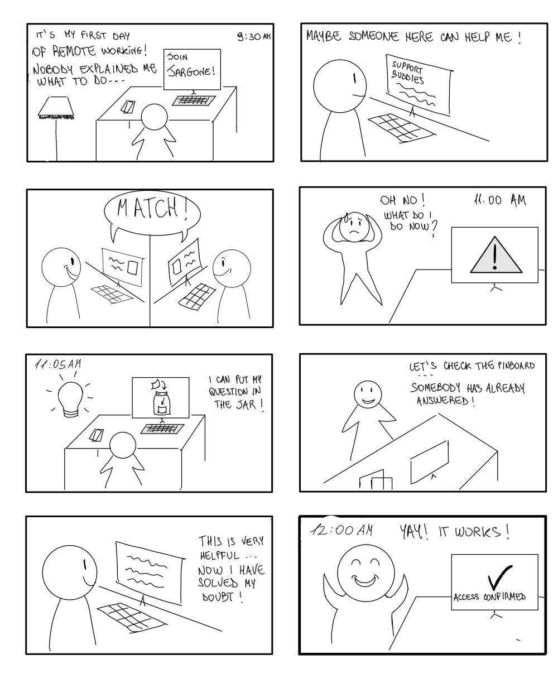

# 1. Intro 

## a. Project title and team members

Project title: **JarGone**

Team members:
* Lisa Arduini
* Giuseppe Antonio Calvello
* Luisa Crivo
* Francesca De Pascale

## b. Value Proposition 
Questions in, doubts out.

## c. Problem/Solution overview
Asking for help remotely emerged from the interviews as one of the most relevant difficulties, affecting both the person asking for support and the person providing it.

**For the person asking for help**, contacting a colleague can feel intrusive. Some participants reported trying to solve problems independently rather than disturbing someone else.

**For the person providing help**, this hesitation can create the opposite problem. Questions are sometimes accumulated and asked all at once instead of being addressed when they first arise.

Problem : Asking for help and getting to know remote colleagues without feeling like a burden

Solution : helping remote workers ask for help and build relationships with colleagues without feeling like a burden.

# 2. Tasks and storyboard 

## a. List of the simple, moderate, and complex tasks

### Simple Task
Resolve a doubt on a topic

### Moderate Task
Match with a suitable support buddy 

### Complex Task
Get help from a colleague with a specific expertise when the assigned support buddy cannot resolve a problem 

## b. Storyboard: why you chose it, which are its strengths and weaknesses, and how well it achieves the identified goal/user need

The storyboard manages to precisely describe the simple and moderate task.
In particular:
* The first panel represents the context, the remote worker and his first day of work. On his first day at work, he discovers the existence of this app and decides to look for a support buddy to make sure he has someone to rely on in case of need. 
* The moderate task is well represented in the transition between the second and third panels, where the remote worker chooses the support buddy and the match subsequently takes place.
* The simple task is illustrated in the remaining panels, that show the remote worker who manages to solve his problem by entering his question into the virtual jar and then reading the received answer.

### Strenghts: 
- Effective time scan: Entering times into key panels (9:30 AM at the start and 11:00 AM during the crisis moment) gives a sense of urgency and measures the real time of onboarding stress

- Clear use of visual metaphors: Representing the idea of using the app as a lightbulb and then the actual use of the application, translates a digital concept into an intuitive action that is easily understood at glance.

- Visible emotions: There is a stark visual contrast between the fourth panel, where the character has doubtful looks and drops of sweat, and the last panel where the character cheers with his arms raised ("Yay! It works!").

### Weaknesses:

- Narrative continuity jump (Panels 3-4): Between the two panels there is a not so clear narrative passage. What happens between the two scenes is not visible. 

- Little dynamism of the scenes: the setting always remains the same, making the narrative more static. This is due to the static nature of remote work itself.

# 3. Modality exploration

## a. Overview of the alternatives considered
We considered 3 alternatives: 

Firstly, we considered a web application that could be accessed from any device through a web browser, particularly suitable for desktop/laptop users. The remote worker already uses the laptop daily and the keyboard easily permits writing detailed descriptions of problems.
On the other hand, there can be a lack of immediacy in consulting the questions, and less portability compared to a mobile app or a tablet app.

Then we discussed a possible tablet application, due to the bigger screen and ease of use. However, it is less common for people to have a tablet in the workplace compared to a smartphone, and we wanted to create a solution that would be accessible to as many people as possible. 

Finally, we considered a mobile app solution so that we always have the ability to consult the questions at hand and do them on the go. The downsides may be the small screen and limited space for texts that are too long. Writing detailed descriptions of problems may be inconvenient.

## b. Present the two selected alternatives and the motivation

After considering these three alternatives, we decided to focus on a mobile application and a web application.

We selected the mobile application because we wanted JarGone to be easily accessible at any time and from anywhere. Since remote workers may need help while working in different locations, a smartphone allows them to quickly ask questions, check existing answers, and communicate with Support Buddies. Moreover, the touch interface makes interactions with elements such as the jar and the notes more intuitive.

We also selected the web application because remote workers already spend most of their working time on a computer. A larger screen makes it easier to explore the Knowledge Map, read detailed answers, and navigate through the Pinboard. In addition, using a physical keyboard makes writing questions and explaining complex problems more comfortable.

We decided not to select the tablet application because, although it offers a larger screen and touch interaction, tablets are less commonly used in the workplace compared to smartphones and computers.

By choosing these two alternatives, we aim to explore two different ways of interacting with JarGone: the mobile application focuses on portability and quick interactions, while the web application provides more space and comfort for complex tasks.

# 4. Paper prototype #1

## a. Include the high-level flow of the “screens” of your prototype

The high-level flow of the screens of our first prototype is contained in .

## b. How does it connect to the storyboard and the three tasks?

Our first prototype refers to a web application.

### Connection to the storyboard

* Panels 1-2 (first day, “Join JarGone”, “Support Buddies”): The user enters the app and, starting from the home page, opens the My Buddy section from the side menu. This is the starting point of the matching flow (steps 4-5). The user browses the list of available support buddies who satisfy the selected characteristics, opens a profile through View details, and sends a request with an optional note (steps 5-8). 
* Panel 3 (“Match!”): Once the request is accepted, the My Buddy page shows the matched support buddy's profile, his/her status (online or how long ago last seen), and gives the possibility to chat (step 11).
* Panels 4-5 (the problem arises, the user has an idea): The worker clicks on the section The Jar from the side menu, then on the button Insert a Question. He/she writes his/her doubt, can choose to ask anonymously (default option), and adds tags to better define the question and help the right users to find it (steps 1-3). A confirmation message tells that the question has been inserted successfully (step 2).
* Panels 6-7 (checking the Pinboard, “somebody has already answered”). Clicking on My Questions, the user finds his/her questions and uses View answer to read the received reply (steps 12-14). The answer solves his/her doubt. Solved Questions and Open Questions are kept separated.
* Panel 8 (“Yay! It works!”). The question moves to the Solved Questions list, confirming that the problem has been resolved.

### Connection to the three tasks

* Simple task: Resolve a doubt on a topic. It is covered by the flow Home → The Jar → Insert a Question → Insert in the Jar → confirmation → Home → My Questions → Solved Questions → View answer (steps 1-4 and 12-14). The user can also search for already solved questions written by someone else in the past (Home → Solved Questions) and, if he/she cannot find a satisfying answer, insert a new question directly from there. In addition, the screens My Questions → Open Questions allow to change his mind or recover from errors: he/she can edit the question and re-insert it, or delete it (steps 15-19).
In addition, the Answer a Question button (steps 20-22) is related to the other side of the interaction: colleagues who want to help others and feel confident in giving answers, can see open questions and answer them.
* Moderate task: Match with a suitable support buddy. It is covered by the flow My Buddy → Match with a support buddy → View details → Send request (with optional note) → Request sent successfully (steps 4-9). The Cancel buttons (step 10) allow the user to go back at any moment without sending the request. If the user is already matched, the My Buddy page directly shows the buddy and the chat (step 11).
* Complex task: Get help from a colleague with a specific expertise when the assigned support buddy cannot resolve a problem. It is covered by the Who-Knows-What Map (step 23), where the user can find colleagues by expertise and ask them for knowledge.

During the whole course of the navigation experience, the application shows a plant that grows and flourishes as more remote workers are active in answering open questions. Instead, if too many questions remain unsolved for too long, the plant gradually dries up. This idea is meant to encourage collaboration across users, fostering a stronger sense of community and mutual support.
